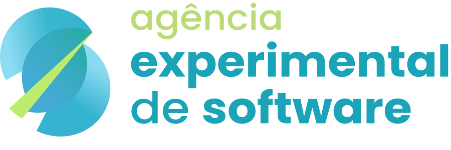
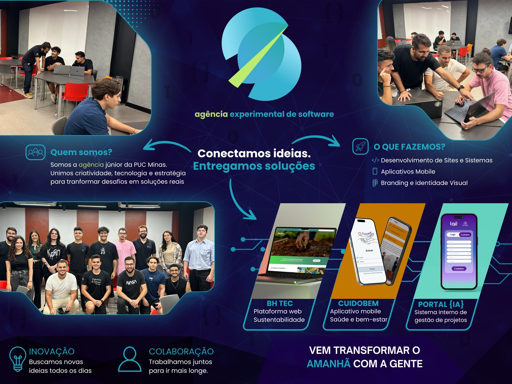
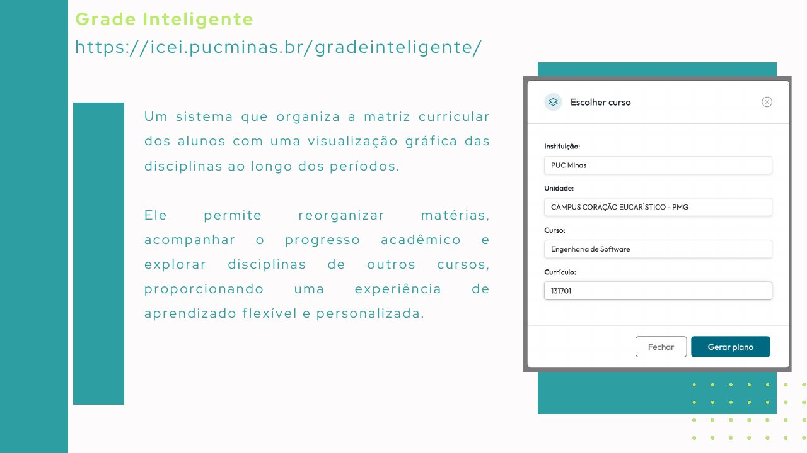
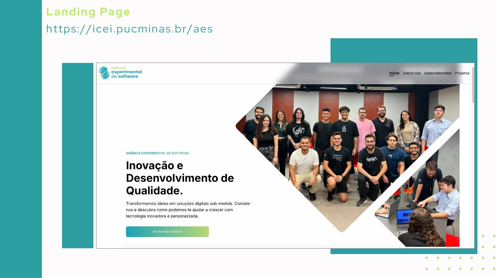
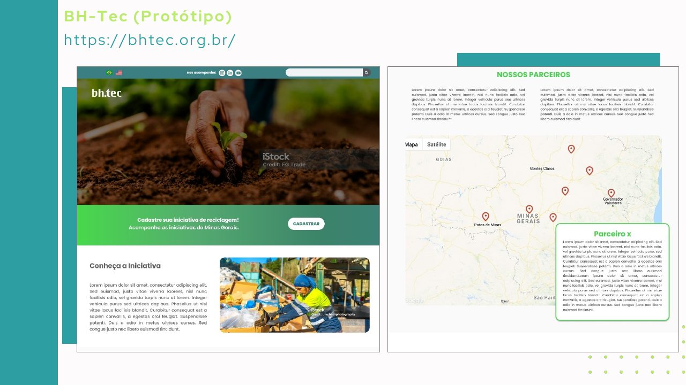
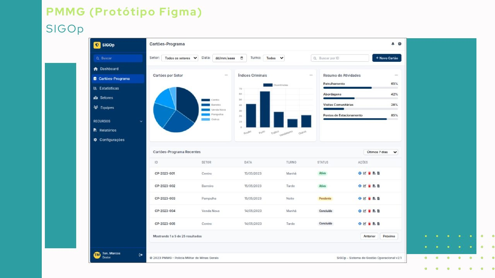
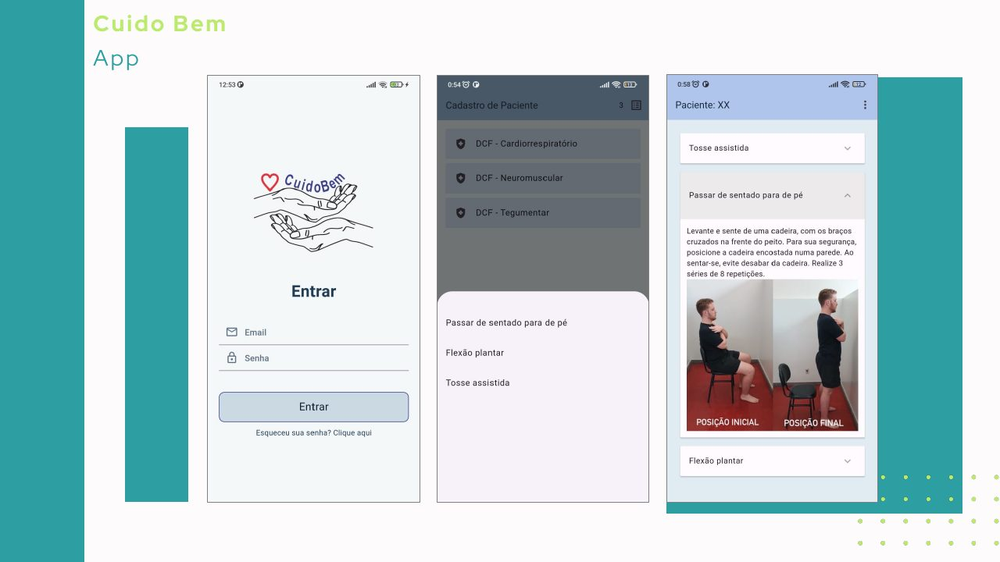
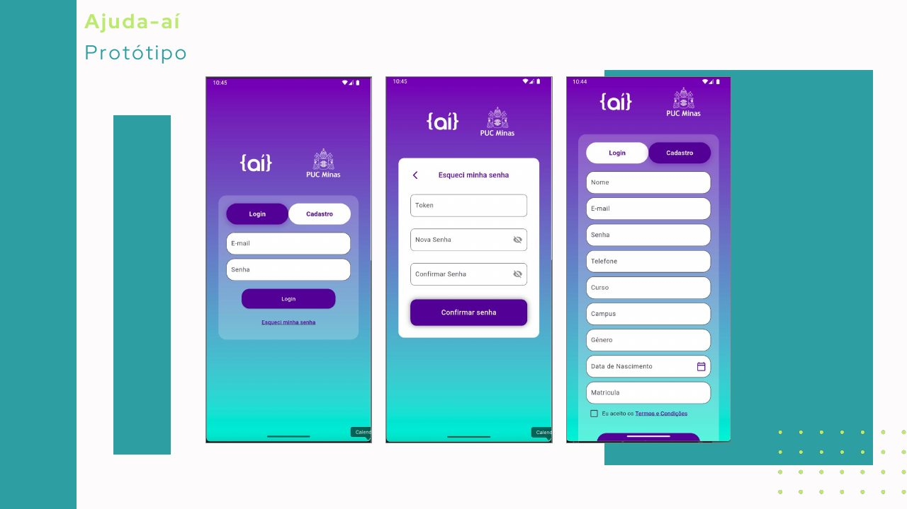

<div align="center">



### Conectamos ideias. Entregamos soluções.

A agência de software dos alunos do **ICEI · PUC Minas**

[](https://icei.pucminas.br/aes/)
[](https://icei.pucminas.br/gradeinteligente/)
[](https://tinyurl.com/forms-agencia)

</div>

<br/>

<p align="center">
  
</p>

---

## 💡 O que é a Agência

A **Agência Experimental de Software (AES)** é uma organização sem fins lucrativos vinculada ao curso de **Engenharia de Software da PUC Minas**. Desenvolvemos soluções tecnológicas reais para clientes internos e externos à universidade, com times formados por alunos e orientados por professores.

Começamos no **segundo semestre de 2023**, e nossa primeira ferramenta, a **Grade Inteligente**, já está disponível para todas as unidades da PUC Minas. O que fazemos aqui não fica no trabalho acadêmico: é software de verdade, usado por clientes de verdade.

**O que fazemos:** desenvolvimento de sites e sistemas web · aplicativos mobile · protótipos e UX/UI · branding e identidade visual.

## 🎯 Nossas metas

| | Meta | Como |
|:-:|---|---|
| 01 | **Desenvolver habilidades e estimular a criatividade** | Aprimorar programação e design, incentivando soluções inovadoras |
| 02 | **Fomentar a colaboração** | Troca de conhecimento entre alunos e profissionais do mercado |
| 03 | **Promover projetos com empresas** | Projetos práticos com parceiros alinhados aos ODS, com impacto positivo na sociedade |
| 04 | **Estimular o empreendedorismo** | Transformar ideias em negócios de software |

---

## 🚀 Projetos

<table>
<tr>
<td width="50%" valign="top">

### 📅 Grade Inteligente
`🟢 Em produção` · Ferramenta interna PUC Minas

Organiza a matriz curricular do aluno numa visualização gráfica das disciplinas ao longo dos períodos. Permite reorganizar matérias, acompanhar o progresso acadêmico e explorar disciplinas de outros cursos.

🔗 [icei.pucminas.br/gradeinteligente](https://icei.pucminas.br/gradeinteligente/)

</td>
<td width="50%"></td>
</tr>

<tr>
<td width="50%"></td>
<td width="50%" valign="top">

### 🌐 Landing Page da AES
`🟢 Em produção` · Ferramenta interna

O site da Agência: apresenta o time e os projetos e recebe demandas de novos clientes. Backend em Node.js com Prisma e PostgreSQL, documentado com Swagger e empacotado em Docker.

🔗 [icei.pucminas.br/aes](https://icei.pucminas.br/aes/)

</td>
</tr>

<tr>
<td width="50%" valign="top">

### 🌱 Mapa de Soluções para Sustentabilidade — BH-Tec
`🟡 Protótipo` · Parceiro: [BH-Tec](https://bhtec.org.br/)

Plataforma web que mapeia e dá visibilidade a instituições (empresas, startups, centros de pesquisa e ONGs) com foco em sustentabilidade em Minas Gerais. Tem mapa interativo com busca e filtros por setor, cadastro de instituições e painel administrativo para aprovação, além de métricas que subsidiam discussões governamentais.

</td>
<td width="50%"></td>
</tr>

<tr>
<td width="50%"></td>
<td width="50%" valign="top">

### 🚓 PMMG — Cartão-Programa
`🟡 Protótipo` · Parceiro: Polícia Militar de Minas Gerais

Novo módulo para o SiGOp que automatiza a criação de cartões-programa (a lista de atividades de cada viatura por turno) a partir das estatísticas criminais. O gestor recebe sugestões, edita e gera o PDF; o executor vê uma versão simplificada.

</td>
</tr>

<tr>
<td width="50%" valign="top">

### 🩺 Cuido Bem
`🟡 Protótipo` · Parceiros: Fisioterapia PUC Minas e Instituto Mário Penna

Aplicativo que substitui as cartilhas físicas e orienta pacientes com câncer nos exercícios fisioterapêuticos pós-alta, facilitando o acesso às informações e o tratamento em casa.

</td>
<td width="50%"></td>
</tr>

<tr>
<td width="50%"></td>
<td width="50%" valign="top">

### 🤝 Ajuda-aí
`🟡 Protótipo` · Ferramenta interna PUC Minas

Leva o programa de apadrinhamento da Engenharia de Software a todos os cursos da PUC Minas. Centraliza informações, resolve problemas de comunicação e conecta padrinhos e apadrinhados com um algoritmo de *match* personalizado.

🎨 [Protótipo no Figma](https://tinyurl.com/ajuda-ai-figma)

</td>
</tr>
</table>

### Em andamento

| Projeto | Parceiro | Sobre |
|---|---|---|
| 🪖 **PMMG — RH Concurso** | Polícia Militar de Minas Gerais | Modernização do fluxo de concursos, com foco no gargalo dos exames médicos e em processos 100% auditáveis |
| 🏗️ **Assistente de IA para concreto** | MRV | Assistente com arquitetura RAG que recomenda o tipo de concreto (MPa e dosagem) para cada etapa da obra, com justificativas baseadas em normas técnicas |
| 💊 **Gestão de estoque de farmácia** | APAC | Sistema web de estoque com Next.js, Spring Boot e PostgreSQL |
| 🧠 **Portal {IA}** | Interno | Sistema interno de gestão dos projetos da Agência |

---

## 🧩 Como a Agência funciona

```
Professores (CTOs)  ──►  Team Leads  ──►  Times de desenvolvimento
   orientação técnica      um por projeto      dev web e mobile, UX/UI,
   e relação com clientes  + DevOps / Nuvem     DevOps, gestão (PO / Scrum)
```

* **Reunião geral** com todos os times às sextas, e reuniões internas de cada time em horário combinado.
* **Dedicação**: cerca de 4 horas por semana (2 h de reuniões + 2 h de desenvolvimento), com flexibilidade em semana de provas.
* **Gestão** dos projetos no [GitHub Projects da organização](https://github.com/orgs/agencia-experimental-de-software/projects), com documentação padronizada: documento de visão, casos de uso, levantamento de requisitos e atas.

<div align="center">

| 👩‍🎓 2º sem. 2024 | 👩‍💻 1º sem. 2025 | 🧑‍🏫 Professores | 🗂️ Times ativos |
|:-:|:-:|:-:|:-:|
| **43 alunos** | **35 alunos** | **6 envolvidos** | **6 projetos** |

</div>

### Coordenação

**Prof. João Paulo Aramuni** · **Prof. Laerte Xavier** · **Prof. Cristiano de Macedo**
<br/>Apoio e consultoria: Prof. Hayala · Profa. Soraia · Prof. Gabriel Barbosa

Agradecimento especial ao **CRC** da PUC Minas pelo suporte e pela estrutura para as soluções da AES.

---

## 🙋 Quero participar

**Benefícios:** horas de ACG · mentoria de professores experientes · cursos exclusivos de frameworks · hard e soft skills · um projeto real no portfólio.

<details>
<summary><b>Quem pode participar?</b></summary>
<br/>
Qualquer aluno de qualquer curso de tecnologia do ICEI, a partir do primeiro período. Não é exigida experiência prévia: os líderes dos times estão em períodos mais avançados, muitos já atuam no mercado, e os professores acompanham de perto.
</details>

<details>
<summary><b>Quais os requisitos?</b></summary>
<br/>
Vamos construir juntos uma aplicação de software completa. Qualquer habilidade útil para isso ajuda: código web ou mobile, Figma, DevOps ou gestão de projetos (como um Scrum Master ou PO). Mais importante que isso é ter disposição para aprender.
</details>

<details>
<summary><b>Quanto tempo preciso dedicar?</b></summary>
<br/>
Cerca de 4 horas semanais: ao menos 2 horas de reuniões e ao menos 2 horas de desenvolvimento. Dá para flexibilizar em semanas de prova.
</details>

<details>
<summary><b>As reuniões são presenciais ou online?</b></summary>
<br/>
A princípio, online. Há uma reunião geral às sextas e outra de cada time, com horário combinado para que todos possam participar.
</details>

<details>
<summary><b>Quais são as minhas responsabilidades?</b></summary>
<br/>
Estar presente nas reuniões e contribuir de verdade com o projeto do seu time. Parece simples, mas exige tempo e compromisso de todos.
</details>

<details>
<summary><b>Quantas vagas existem e como entro?</b></summary>
<br/>
Não há um número fixo de vagas. Os alunos entram pelos processos seletivos semestrais, divulgados no <a href="https://icei.pucminas.br/aes/">site da Agência</a> e nos canais do ICEI.
</details>

## 🏢 Tem um projeto para a gente?

Empresas, ONGs, órgãos públicos e áreas da própria universidade podem propor projetos para a Agência. Damos prioridade a iniciativas com impacto social e alinhadas aos Objetivos de Desenvolvimento Sustentável.

<p align="center">
  <a href="https://tinyurl.com/forms-agencia"></a>
</p>

---

<div align="center">

**Vem transformar o amanhã com a gente.** 💙💚

[icei.pucminas.br/aes](https://icei.pucminas.br/aes/) · Engenharia de Software · ICEI · PUC Minas

</div>
